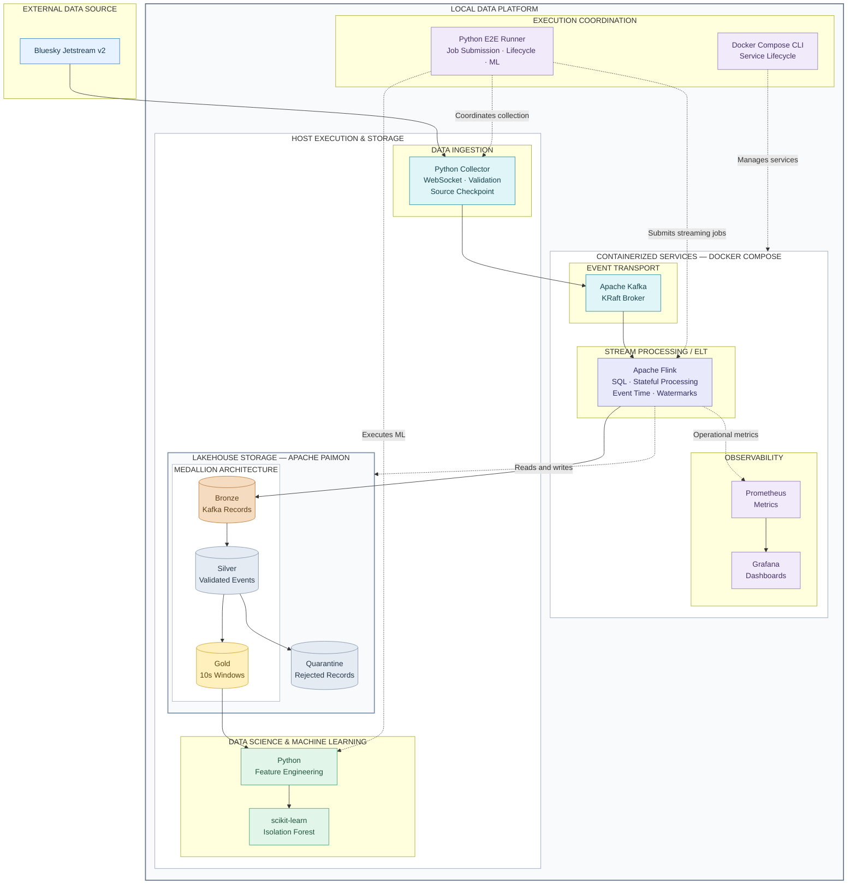

# Bluesky Streaming Platform

**Real-Time Data Engineering | Streaming ELT | Lakehouse | Machine Learning**

An end-to-end data engineering portfolio project that collects
real public events from Bluesky Jetstream and transforms them
into validated analytical datasets and experimental anomaly detection.

The platform demonstrates a **streaming-oriented Modern Data Stack**,
combining Apache Kafka, Apache Flink, Apache Paimon, Python,
Prometheus, Grafana and scikit-learn.

> **Status:** End-to-end execution successfully validated.
> This is a portfolio proof of concept, not a production service.

## Modern Data Stack Architecture

The architecture separates data ingestion, streaming transformation,
lakehouse storage, machine learning, execution coordination and
observability.



### Architecture Layers

| Layer | Technologies | Responsibility |
|---|---|---|
| Data Source | Bluesky Jetstream v2 | Public activity events |
| Ingestion | Python, WebSocket | Collection, validation and source checkpointing |
| Event Transport | Apache Kafka | Event buffering and delivery |
| Streaming ELT | Apache Flink SQL | Stateful transformations and event-time aggregation |
| Lakehouse Storage | Apache Paimon | Bronze, Silver, Gold and Quarantine |
| Data Science & ML | Python, scikit-learn | Feature engineering and Isolation Forest |
| Execution Coordination | Python E2E Runner | Controlled job execution and ML lifecycle |
| Infrastructure | Docker Compose | Containerized service lifecycle |
| Observability | Prometheus, Grafana | Operational metrics and dashboards |

Apache Paimon is integrated with Flink and persists tables
on the local filesystem. It is not deployed as a separate
database server.

Python processes execute on the host, while Kafka, Flink
and monitoring services run through Docker Compose.

## Medallion Architecture

**Bronze** preserves minimized Kafka event payloads and
transport metadata.

**Silver** validates event contracts and separates supported
records from rejected records sent to Quarantine.

**Gold** materializes finalized ten-second event-time windows
with activity counts and operation-level aggregates.

The Gold output is used to derive features for the
Isolation Forest experiment.

## Validated End-to-End Execution

The platform successfully completed an isolated execution
with real Bluesky events.

**Run ID:** `671370fce3cc`

| Metric | Result |
|---|---:|
| Real events collected | 8,345 |
| Bronze records | 8,345 |
| Valid Silver records | 8,345 |
| Quarantined records | 0 |
| Finalized Gold windows | 17 |
| Events represented in Gold | 7,554 |
| Silver events outside finalized windows | 791 |
| Gold window mismatches | 0 |
| Late records dropped | 0 |
| Preserved Flink savepoints | 3 |
| ML training / evaluation windows | 11 / 6 |
| End-to-end result | **PASSED** |

Events outside finalized Gold windows were accounted for
during reconciliation and must not be interpreted as lost data.

The ML experiment demonstrates successful training and inference,
not statistically validated production anomaly detection.

## Getting Started

**Prerequisites:** Python 3.11+, Docker, Docker Compose,
network access to Bluesky Jetstream and sufficient local resources.

```bash
git clone https://github.com/fabiodonizetibaptista/bluesky-streaming-platform.git
cd bluesky-streaming-platform

python3 -m venv .venv
.venv/bin/python -m pip install -e ".[ml,dev]"
```

Follow the [Operations Guide](docs/operations/README.md)
to install Flink connectors and start the infrastructure.

Once Kafka and Flink are running, execute the integrated workflow:

```bash
E2E_MIN_EVENTS=3000 \
E2E_MIN_DURATION_SECONDS=180 \
E2E_MAX_EVENTS=250000 \
E2E_MAX_DURATION_SECONDS=360 \
.venv/bin/python -u scripts/run_e2e_final.py
```

Run the automated tests:

```bash
.venv/bin/python -m pytest -q
```

The validated regression suite reported
42 passed tests and 18 passed subtests.

## Technical Documentation

| Topic | Documentation |
|---|---|
| System Architecture | [Architecture](docs/architecture/README.md) |
| Bluesky and Kafka Ingestion | [Ingestion](docs/ingestion/README.md) |
| Flink and Paimon Processing | [Processing](docs/processing/README.md) |
| Operational Monitoring | [Observability](docs/observability/README.md) |
| Feature Engineering and ML | [Machine Learning](docs/machine-learning/README.md) |
| End-to-End Experiment | [E2E Validation](docs/e2e/README.md) |
| Installation and Recovery | [Operations](docs/operations/README.md) |

Historical engineering documentation is retained under `docs/`.

## Engineering Scope

This project demonstrates practical streaming data engineering:
source ingestion, messaging, stateful processing, medallion storage,
event-time analytics, operational visibility and ML integration.

It is designed for learning and technical portfolio demonstration.

The single-node deployment does not claim production high
availability or universal end-to-end exactly-once delivery.
